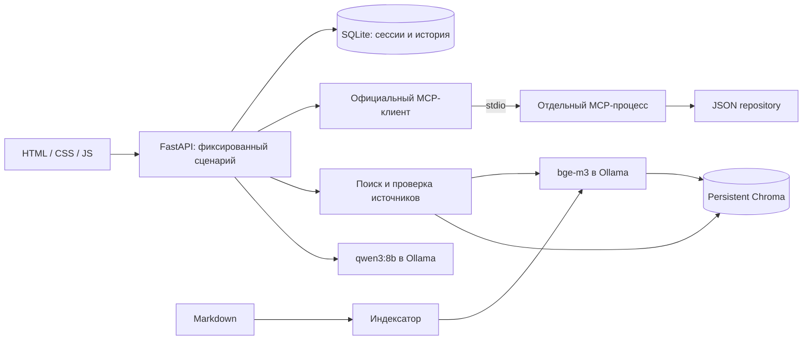

# TeamSpace — локальный ассистент поддержки

Работающий учебный MVP: русский веб-чат, RAG по 19 статьям, 5 синтетических пользователей, 10 тикетов, история SQLite и отдельный MCP-процесс. Никаких облачных LLM, загрузки моделей и внешних ресурсов интерфейса. Только уже установленная Ollama: **qwen3:8b** и **bge-m3**.

## Установка и запуск

Проверено на macOS arm64, Python **3.14.0**. Проект допускает Python 3.11–3.14; другие версии Python/ОС здесь не проверялись. Полный набор разрешённых версий закреплён в `requirements.lock`, прямые зависимости — в `pyproject.toml`: FastAPI 0.146.0, Uvicorn 0.54.0, Pydantic 2.14.1, pydantic-settings 2.16.0, httpx 0.28.1, Chroma 1.5.9, официальный MCP SDK 1.30.0, pytest 9.1.1, pytest-asyncio 1.4.0.

Из корня checkout:

```bash
python3.14 -m venv .venv
.venv/bin/python -m pip install -r requirements.lock
.venv/bin/python -m pip install --no-build-isolation --no-deps -e .
cp .env.example .env
```

Укажите адрес уже работающей Ollama в `.env`:

```dotenv
OLLAMA_BASE_URL=http://localhost:11434
OLLAMA_CHAT_MODEL=qwen3:8b
OLLAMA_EMBED_MODEL=bge-m3
```

Если Ollama на другом компьютере, замените только адрес. Поддержку моделей можно проверить `curl http://localhost:11434/api/tags` (для удалённой машины подставьте её адрес). Ожидаются `qwen3:8b` и `bge-m3:latest`; последнее имя соответствует запросам `model=bge-m3`. Проект ничего не скачивает автоматически и не заменяет модели.

```bash
.venv/bin/support-assistant seed
.venv/bin/support-assistant index
.venv/bin/support-assistant doctor
.venv/bin/support-assistant serve
```

Откройте **http://127.0.0.1:8000**. `serve` слушает только loopback, один worker. MCP запускается автоматически. `seed` валидирует весь набор JSON через MCP и создаёт SQLite без удаления истории. `index` требует работающей bge-m3; `doctor` проверяет модели, MCP, индекс и делает короткую реальную генерацию для проверки `think=false`. До первой индексации `doctor` закономерно сообщает `INDEX_MISSING` и возвращает код 1.

Команды проверены в этой среде. Установка выполнена в локальную `.venv`; `pip check` не обнаружил конфликтов. Доступ к localhost из песочницы Codex потребовал разрешения, за её пределами Ollama доступна. Этот барьер среды не требует изменений кода.

## Демонстрация

1. Выберите **Анна**, тикет **t_101**, нажмите «Новый диалог».
2. Спросите: **«Почему не работает авторизация?»**. Ожидается объяснение `SSO_CERT_EXPIRED`: истёк сертификат SAML, администратор заменяет его и проверяет вход.
3. Раскройте «На основании чего дан ответ», откройте статью «Сертификаты SSO» и доступный тикет. Статья открывается как безопасный текст в новой вкладке.
4. Спросите «А что делать дальше?». Контекст сертификата должен сохраниться. Перезагрузите страницу — активный диалог восстановится. Другие диалоги доступны в списке.
5. Переключитесь на **Борис**, выберите **t_102**, создайте новый диалог и задайте тот же вопрос. Ожидается `ACCOUNT_TEMP_LOCKED`: 5 неудачных попыток, блокировка 15 минут, повтор не раньше 10:15 UTC для времени из тикета.
6. Для общего вопроса выберите «Без тикета» и новый диалог. Например: «Сколько стоит тариф Team и сколько участников он допускает?».

Выбор пользователя очищает активный диалог. Переписка другого пользователя не переносится. Выбор тикета действует для нового диалога; существующий тикет изменить нельзя. Enter отправляет сообщение, Shift+Enter добавляет строку. Во время запроса элементы выбора и отправка заблокированы. Ошибка сохраняет набранный текст для повторной попытки.

## Архитектура и границы доверия



RAG предоставляет продуктовые знания, MCP — персональный контекст, SQLite — историю. Backend не импортирует серверные инструменты/repository и не читает персональные JSON. MCP-клиент выполняет `initialize`, `list_tools`, `call_tool`, проверяет `isError` и структурированный ответ. На одну операцию контекста запускается процесс с неизменяемым `MCP_SUBJECT_USER_ID`. Все нужные инструменты вызываются внутри одного подключения; процесс закрывается и при ошибке, тайм-ауте или отмене.

Инструменты: `get_current_user()`, `list_my_tickets(status?)`, `get_ticket(ticket_id)`, `list_demo_users()`. Без субъекта разрешён только каталог с ID и именем; каталог отключён при `DEMO_MODE=false`. Чужие и несуществующие тикеты дают одинаковый `NOT_FOUND`. Произвольный `user_id` в chat-запросе запрещён схемой; текст и модель не выбирают MCP-субъект. MCP stdout занят протоколом, логи идут в stderr.

Для CRM реализуйте `Repository` из `src/support_assistant/mcp/repository.py`, замените создание `JsonRepository` внутри MCP-сервера. Сохраните схемы `User`/`Ticket`, проверку субъекта и владельца. Контракты MCP и backend менять не нужно. Инструментов записи нет.

Сессия — случайный непрозрачный token, привязка к пользователю в SQLite; cookie HttpOnly/SameSite=Strict, без Secure для локального HTTP. Изменяющие запросы требуют точного разрешённого Origin, произвольный CORS отсутствует. Это **демонстрационная идентификация**, а не промышленная авторизация: любой локальный посетитель может выбрать любую демо-личность через предусмотренный переключатель.

## Поиск, индексация и генерация

Статьи — Markdown с JSON front matter между `---` (JSON — подмножество YAML). Поля: `doc_id`, `title`, `product`, `version`, ISO-время `updated_at`, массив `error_codes`. `doc_id` стабилен и уникален. Для явно общих статей используйте `product: general`, `version: "*"`.

Фрагменты формируются по заголовкам и абзацам; абзацы длиннее 2000 символов делятся с перекрытием 200. Короткие смысловые секции сохраняются отдельно. Число и размерность dense-векторов проверяются. Chroma **всегда открывается с `embedding_function=None`**; запись получает `embeddings`, поиск — `query_embeddings`. Встроенная модель не вызывается, её загрузка не нужна. В Chroma нет пользователей, тикетов и истории.

Манифест хранит модель, размерность, схему, параметры chunking и cosine. Новая коллекция создаётся после получения всех embeddings; указатель `manifest.json` заменяется атомарно после записи. Затем старые коллекции удаляются. Повторная индексация не накапливает дубликаты; удалённые статьи исчезают. При изменении содержимого источника поиск требует переиндексацию, чтобы ссылка не показывала другой текст.

Запрос содержит вопрос, предыдущий вопрос для короткого продолжения, тему/код тикета, продукт/версию; поля имени и email из профиля не добавляются. Поиск использует два bge-m3-вектора: полный контекст и вариант без суффикса продукта/версии. Последний получил вес 0.8, полный — 0.2: live-проверка показала, что название TeamSpace вытесняло короткий вопрос «Где скачать счёт?». Сначала Chroma возвращает кандидатов для обоих векторов, затем они ранжируются по взвешенному cosine distance. Порог **0.48**, ниже — ближе. Это расстояние, **не вероятность правильного ответа**. Значения выбраны на демонстрационных вопросах, независимой оценки на отдельном корпусе нет. Точное совпадение кода ошибки приоритетнее; продукт/версия фильтруются, дубликаты убираются. `RAG_TOP_K=5` означает максимум 5 фрагментов, не обязательно 5 разных статей.

Лимиты: вопрос 2000 символов, история последние 12 сообщений и максимум 6000 символов, RAG 10000 символов, сообщения тикета последние 3 по 1500 символов. Ollama получает `num_ctx=8192`, `num_predict=1800`, `temperature=0.2`, `stream=false`, `think=false`. Ограничение символами приблизительное и не равнозначно числу токенов. Генерации сериализованы в одном процессе, повторный запрос в тот же диалог отклоняется с 409. Синхронные операции Chroma выполняются в рабочем потоке.

Модель возвращает JSON Schema (`answer`, `source_ids`, `needs_clarification`). Для тикета с кодом ошибки схема дополнительно требует непустой `next_steps` (до 5 шагов по 600 символов): backend добавляет эти сгенерированные действия к объяснению. Так пропуск действий не проходит как полный ответ; сами действия не захардкожены. Backend валидирует формат, доступность source ID и персональные ID в тексте, строит URL только из разрешённого контекста. Максимум одна повторная попытка исправления, затем `LLM_FORMAT`; заранее подготовленного «ответа AI» при сбое нет. Уточнение выбора тикета и сообщение об отсутствии релевантных знаний — явные ветки оркестратора, а не имитация генерации. Неуспешные попытки сохраняются со статусом ошибки, успешного сообщения ассистента в истории не появляется.

## API

Машинный контракт: **GET `/openapi.json`**. Внешний Swagger/CDN отключён.

| Метод и путь | Контракт |
|---|---|
| GET `/api/demo/users` | Каталог `{id,name}` через MCP |
| POST `/api/demo/session` | `{"user_id":"u_001"}`, новая cookie |
| GET `/api/me` | Профиль текущей сессии через MCP |
| GET `/api/tickets` | Краткие тикеты текущего пользователя |
| GET `/api/tickets/{id}` | Полный тикет, проверка владельца в MCP |
| POST `/api/conversations` | `{"ticket_id":"t_101"}` или `{"ticket_id":null}` |
| GET `/api/conversations` | Только собственные диалоги |
| GET `/api/conversations/{id}/messages` | История, проверка владельца |
| POST `/api/chat` | `{"conversation_id":"…","message":"…"}` |
| GET `/api/knowledge/{doc_id}` | Известная статья как `text/plain`, без произвольных путей |
| GET `/api/health` | Статусы API, моделей, MCP, индекса; без пробной генерации |

Ответ чата: `conversation_id`, `answer`, `sources`, `needs_clarification`, `context_status`, `request_id`, `ticket_id`, `retrieved_doc_ids`. Источники имеют `type`, `id`, `title`, `url`, у статьи также `section`. `context_status`: `complete`, `needs_ticket`, `no_relevant_knowledge`. Отказ MCP возвращается 503, общий ответ со старым персональным контекстом не генерируется. Ошибки: `{code,message,request_id}`; тот же ID есть в заголовке `X-Request-ID`. В логах — ID запроса, стадии/длительность, имена инструментов и doc_id, без полных персональных данных.

Для ручных POST через curl добавьте `Origin: http://127.0.0.1:8000` и сохраняйте cookie. При смене порта обновите `APP_PORT` и `APP_ORIGINS` одновременно.

## Проверки

Фактически: **24 обычных теста прошли**; полная live-оценка выполнила 17 сценариев, строгие проверки прошли в 15, поиск — 14/14. Два оставшихся несовпадения — буквальное слово в ответе об уведомлениях и флаг уточнения на атакующий запрос. Отдельная live-регрессия атрибуции без тикета прошла после последней правки. Подробности и границы проверки — [протокол](evaluation/VERIFICATION.md); `all_checks_passed=false` в полном отчёте сохранён честно.

Обычные тесты **не требуют Ollama**:

```bash
.venv/bin/python -m pytest -q
```

Они подменяют только HTTP-границу Ollama; используют настоящую временную Chroma, настоящий MCP subprocess/протокол и SQLite. Покрыты discovery всех инструментов, доступ, две параллельные личности, закрытие процессов при ошибке/тайм-ауте/отмене, повреждённый JSON, история после перезапуска, контекст двух ошибок и продолжения, индексация/обновление/удаление, несовместимость, отсутствие знаний, сбои моделей и MCP, неправильные source IDs и prompt injection.

Отдельная оценка с **реальными** зависимостями:

```bash
.venv/bin/support-assistant evaluate
# Либо полная оценка и целевая регрессия через pytest (обычный запуск их исключает):
.venv/bin/python -m pytest -m live tests/live -q
```

17 кейсов находятся в `evaluation/cases.json`. Команда сохраняет фактические ответы, найденные doc_id, открытое содержимое источников, задержки и проверки в `evaluation/live-report.json`. Она создаёт отдельные демонстрационные диалоги в текущей SQLite, не удаляет имеющиеся. Код завершения 1 означает хотя бы одну проваленную проверку. Отчёт перезаписывается новым запуском.

Метрика поиска — доля кейсов с ожидаемыми документами, где все ожидаемые doc_id найдены среди top-k фрагментов. Для атакующего кейса допускается отдельно помеченный безопасный отказ `LLM_FORMAT`; это не успешная генерация. Поиск дополнительно проверяется независимо от результата генерации. Проверки генерации используют ожидаемые/запрещённые подстроки (для синонимов допустим список вариантов) и флаг уточнения. Это регрессии, **не полноценная семантическая оценка**. Открытая ссылка и корректный ID не доказывают каждое утверждение модели. Фактический протокол проверки и ограничения — `evaluation/VERIFICATION.md`.

## Обновление знаний и данные

1. Остановите `serve` (Ctrl+C).
2. Добавьте или измените Markdown в `knowledge_base`, сохранив стабильный `doc_id`.
3. Выполните `.venv/bin/support-assistant index` и `.venv/bin/support-assistant doctor`.
4. Запустите `.venv/bin/support-assistant serve`.

**Индексировать при работающем сервисе нельзя:** полный rebuild рассчитан на остановленный web-процесс. Для сохранения текущих данных не удаляйте `var`. SQLite (`var/support.sqlite3`, включая WAL/SHM при активном сервере) и Chroma (`var/chroma`) сохраняются между запусками и исключены из Git. Для резервной копии остановите сервис и скопируйте весь `var`. `seed` безопасно запускать повторно; разрушительный сброс для работы не нужен.

Пути `.env` разрешаются относительно корня проекта, не cwd дочернего процесса. Editable-установка позволяет запускать CLI и из другой директории. При установке wheel вне checkout задайте `SUPPORT_ROOT=/абсолютный/путь/к/checkout`, где находятся `.env`, `data`, `knowledge_base`, `evaluation`.

## Диагностика и ограничения

| Code / симптом | Что проверить |
|---|---|
| `OLLAMA_UNAVAILABLE` | Работающую Ollama, `OLLAMA_BASE_URL`, доступность сети |
| `MODEL_MISSING` | `/api/tags`: нужны qwen3:8b и bge-m3; автоматической загрузки нет |
| `OLLAMA_TIMEOUT` | Нагрузку/память и `OLLAMA_TIMEOUT_SECONDS` (180 по умолчанию) |
| `OLLAMA_REJECTED` | Совместимость API, модели и параметра `think`; `doctor` делает реальный probe |
| `INDEX_MISSING`, `INDEX_EMPTY` | `support-assistant index` |
| `INDEX_STALE`, `INDEX_INCOMPATIBLE` | Остановить web-сервис и переиндексировать |
| `INDEX_CORRUPT`, `INDEX_WRITE` | Доступ к `CHROMA_PATH`, журнал, резервную копию; rebuild при остановленном сервисе |
| `MCP_UNAVAILABLE` | Установлен ли проект в той же .venv, пути `DATA_PATH`, `SUPPORT_ROOT`, stderr, тайм-аут 20 с |
| `DATA_INVALID` | JSON, уникальность ID, владельцев тикетов, статусы, ISO-время с поясом; `seed` |
| `ORIGIN_REJECTED` | Точное совпадение адреса браузера и `APP_ORIGINS` |
| `LLM_FORMAT` | Модель дважды нарушила схему/источники; переформулировать вопрос |

На установленной Ollama `think=false` подтверждён реальным probe; thinking в UI не выводится. `OLLAMA_THINK=true` — явная ручная настройка, если конкретная версия требует thinking; автоматического переключения или замены модели нет.

Один локальный worker, нет масштабирования, стриминга, настоящей авторизации, CRM-записи и мониторинга сервиса. Производительность зависит от оборудования и холодной загрузки моделей. Данные тикета — запись обращения, не проверка текущего состояния. Защита от инструкций в данных снижает риск, но не доказывает невозможность смысловых ошибок модели. Телеметрия Chroma отключена, OTEL SDK отключён; интерфейс и inference после установки не требуют внешних сервисов.

API сверены с официальными источниками и установленными SDK: [Ollama embed](https://docs.ollama.com/api/embed), [Ollama chat](https://docs.ollama.com/api/chat), [Chroma embedding functions](https://docs.trychroma.com/docs/embeddings/embedding-functions), [Python MCP SDK](https://github.com/modelcontextprotocol/python-sdk).
